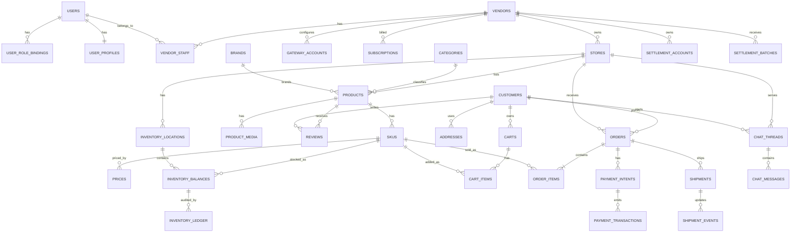
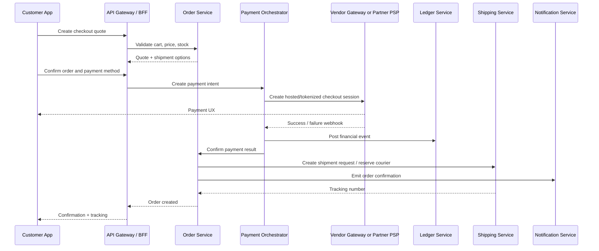
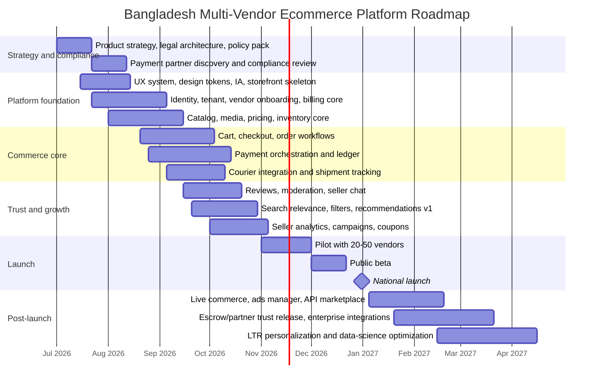

# World-Class Multi-Vendor Ecommerce Platform for Bangladesh

## Executive summary

A Bangladesh-first marketplace can become competitive with Daraz-class and AliExpress-inspired products only if it is designed as a **commerce operating system**, not merely as a “vendor store hosting” app. The strongest public signals from Daraz and AliExpress point in the same direction: both platforms combine marketplace traffic with fulfillment/logistics support, buyer protection, payment orchestration, rich merchandising surfaces, seller tooling, and algorithmic discovery. Daraz publicly positions itself as South Asia’s leading ecommerce platform with access to 50 million products and 40 million monthly active users across its markets, operates in Bangladesh since 2015, works with more than 550,000 sellers, and has expanded logistics and live-commerce capabilities. Alibaba’s public materials show AliExpress leaning heavily into its Choice program and “Fulfilled by AliExpress,” where merchants focus more on supply chain while the platform reduces retail-operational friction. citeturn26search7turn21search4turn28search5turn26search15turn28search2turn24search0turn6view0turn24search4

For Bangladesh specifically, the product must be **mobile-first, Bangla-first, trust-first, and operations-first**. BTRC-referenced industry statistics show internet subscribers in Bangladesh at 131.42 million by April 2026, including 116.47 million mobile internet subscribers, which strongly favors app-led commerce and lightweight mobile web flows. Daraz’s Bangladesh storefront emphasizes COD, bKash, Nagad, Rocket, EMI, and nationwide delivery, while its app promotes free returns, live streaming, and official-brand buying through Daraz Mall. That means a new entrant cannot win on listing pages alone; it must win on checkout confidence, delivery visibility, local payments, and after-sales governance. citeturn19search0turn21search0turn21search2

The best product strategy is therefore a **hybrid SaaS + marketplace services model**: charge vendors a one-time onboarding fee and monthly subscription, but do not stop there. Add optional commissions, advertising, logistics orchestration, payment orchestration, premium storefront themes, API access, analytics, and cross-border enablement. A pure flat-fee model under-monetizes success and weakens your ability to subsidize buyer acquisition; the public behavior of AliExpress and Daraz suggests that the winning flywheel is built on GMV-linked services and operational leverage, not only on rent for a hosted storefront. This conclusion is an inference from their public seller scale, logistics investments, live-commerce tools, fulfillment layers, recommendation-heavy consumer apps, and platform APIs. citeturn28search5turn26search1turn26search15turn28search2turn44search1turn24search0turn24search2turn24search4

My central recommendation is to build the platform as a **modular core with event-driven boundaries**, rather than jumping directly to a fully distributed microservices estate on day one. Public cloud guidance consistently notes that monoliths are simpler to start while microservices improve independent scaling and team autonomy but add substantially more distributed-systems complexity. For your case, a world-class outcome comes from designing the domains as if they will become services, while initially shipping them as a modular monolith plus dedicated search, cache, chat, analytics, and event infrastructure. This gives you faster delivery, easier debugging, and lower operating cost in the Bangladeshi launch phase, while preserving a clean path to later service extraction. citeturn30search0turn30search11turn30search4turn30search21

From a regulatory and trust perspective, the platform must be built around Bangladesh’s digital-commerce, payment, and consumer-protection rules from the start. The Ministry of Commerce’s **Digital Commerce Porichalona Nirdeshika 2021** requires clear disclosures for product descriptions, warranties, pricing and delivery timelines; requires trade-license, VAT/TIN, and digital commerce identifiers to be displayed; requires transaction records retention; restricts unlicensed financial activity; and limits payout timing from marketplace owner to seller unless otherwise agreed. Bangladesh Bank’s MFS regulations explicitly cover online and e-commerce payments, require AML/CFT compliance, and define trust-cum-settlement concepts for payment services. These rules mean your payment architecture, seller onboarding, moderation, and ledger design cannot be an afterthought. citeturn42view1turn42view2turn42view3turn43view0turn12search0turn12search1

## Market and competitor benchmark

### Bangladesh market realities

Bangladesh is already large enough to justify a serious platform build, but the shape of the demand matters more than the headline population. Mobile access dominates internet access, and public digital reports show improving mobile bandwidth as well, which supports rich app experiences such as image-led discovery, live commerce, chat, and personalized feeds. The practical implication is that the consumer product should prioritize fast category browse, resilient mobile checkout, Bangla policy surfaces, push notifications, and cached media delivery rather than desktop-only merchant workflows. citeturn19search0turn19search7

Daraz’s Bangladesh storefront and app reveal the local baseline customer expectation: COD, cards, bKash, Nagad, Rocket, easy returns, branded storefronts, delivery, installability through mobile apps, and aggressive campaign-led merchandising. Daraz also promotes personalized shopping, flash deals, and live streaming; those are not “nice-to-have” extras anymore, but part of the competitive minimum for large-scale consumer commerce in Bangladesh and South Asia. citeturn21search0turn21search2turn44search3

### What AliExpress optimizes for

Public Alibaba materials make clear that AliExpress is not just a listing marketplace; it is increasingly a logistics- and fulfillment-enhanced global commerce engine. AliExpress’ Choice service is described by Alibaba as a premium ecommerce service underpinned by a strong supply chain, and Alibaba’s annual reporting says merchants using Choice are empowered to focus on supply chain management while the platform reduces retail-commerce operating barriers through “Fulfilled by AliExpress.” Alibaba also said Choice accounted for about 70% of AliExpress total orders in April 2024, and it credited the service with strong order growth. Cainiao, Alibaba’s logistics arm, publicly describes itself as a global leader in cross-border ecommerce logistics and the largest provider of such services globally. citeturn24search0turn6view0turn24search4turn5search5

AliExpress’s consumer app description reinforces the user-facing part of that operating model: broad product variety, communication with merchants, secure payment, delivery tracking, and personalized recommendations. In other words, AliExpress wins by making seller fragmentation invisible to the buyer. The buyer experiences one coherent commerce layer; the seller experiences a large demand engine with layered operational services. citeturn4search0

AliExpress also illustrates the downside risk of scale without sufficiently strong governance. Reuters and the European Commission reporting show AliExpress entering binding commitments and facing ongoing scrutiny over illegal products, vendor traceability, and recommendation transparency. For your owner presentation, this is strategically important: if the platform wants world-class scale, seller verification, restricted-category governance, and content moderation must be budgeted as core infrastructure, not as customer-support overhead. citeturn25news11turn25search0

### What Daraz optimizes for

Daraz’s public positioning is more regional and operationally localized than AliExpress. Daraz says it operates across Bangladesh, Pakistan, Sri Lanka, Nepal, and Myanmar. Its “Who we are” materials state that after Alibaba acquired Daraz, the company underwent a tech transformation to Alibaba technology and launched Daraz Express as a full-range logistics company. Daraz also partnered with Alibaba Cloud in Pakistan and, with Cainiao, developed smart distribution centers. These disclosures strongly suggest a marketplace strategy centered on platform technology, logistics control, operational standardization, and regional reuse. citeturn26search0turn26search1turn26search3turn26search15

Daraz’s app and storefront show three especially relevant lessons for your platform. First, it localizes payments deeply through COD and major local payment methods. Second, it uses multiple discovery surfaces beyond search, including campaign pages, brand malls, live streams, and gamified promotions. Third, it supports seller ecosystem tooling through an open platform API and seller center workflows. Public Daraz Live reporting says more than 1.2 million orders were influenced by Daraz Live campaigns and streams in 2022 across 3,000-plus brands and sellers, which is an unusually strong signal that content-led commerce already matters in this market family. citeturn21search0turn21search2turn28search2turn44search1

Daraz’s legal structure in Bangladesh is also instructive for your proposed model. Daraz’s Bangladesh terms say commercial terms such as price, shipping costs, payment methods, and delivery mode are between buyers and sellers, while the site operates the platform and supporting policies. That is close to your “host virtual store” concept, but in practice Daraz still layers heavy trust and process controls above that seller-buyer commercial relationship. A world-class Bangladeshi platform should do the same. citeturn2view3

### The strategic implication for your platform

Your improved concept should be positioned as **“vendor-owned commerce storefronts inside a platform-governed trust, discovery, and operations layer.”** That is a stronger model than “vendors just manage their own store and gateway,” because it lets you preserve seller autonomy while still controlling what truly determines conversion and retention: identity, reviews, ranking, returns, chat experience, payment event normalization, fraud controls, and logistics visibility. The public benchmark from AliExpress and Daraz supports precisely this interpretation. citeturn2view3turn24search0turn24search4turn26search1turn28search2

## Business model and monetization

### Recommended commercial model

The business should be designed with four revenue layers rather than one. The first layer is your original **one-time onboarding fee + monthly subscription**, which works well for recovering seller activation cost, KYC overhead, storefront setup, and support. The second layer is **optional GMV-linked monetization** through low commissions or checkout-orchestration fees. The third is **merchant services revenue** such as ads, premium analytics, API access, advanced themes, premium support, and warehousing/logistics orchestration. The fourth is **financial and trust services revenue**, such as payout acceleration, escrow handling through a licensed partner, installment offers, and seller financing later. This is the structure most consistent with the operational direction visible in Daraz and AliExpress. citeturn28search5turn26search1turn26search15turn24search0turn24search4

A pure subscription-only model is attractive at ideation stage because it is easy to explain, but it has three weaknesses. It decouples your revenue from marketplace success, makes it harder to subsidize buyer growth and fraud losses, and gives fast-growing sellers little reason to upgrade until you force them to. A hybrid model aligns your economics with GMV while keeping the owner’s original “software as platform” philosophy intact. This is partly judgment, but it is grounded in the fact that the public winners in this category invest heavily in fulfillment, content, recommendation, seller tools, and payments—not only storefront hosting. citeturn26search1turn26search15turn28search2turn24search0turn24search2

### Recommended pricing tiers

| Tier | One-time signup fee | Monthly fee | Platform fee model | Best for | Included highlights |
|---|---:|---:|---|---|---|
| Launch | BDT 10,000 | BDT 2,500 | 0% commission if vendor uses fully self-managed checkout; 1% if platform routes payment events and support | Small new sellers | 1 storefront, 500 active SKUs, chat, coupons, COD support, own gateway integration, basic analytics |
| Growth | BDT 25,000 | BDT 7,500 | 1.5%–3% on platform-assisted checkout or optional ad spend | Established SMEs | 5,000 SKUs, offers engine, webhook/API access, store themes, staff accounts, search boosting, return workflows |
| Pro | BDT 60,000 | BDT 18,000 | 2%–5% on orchestrated checkout / logistics / escrow | National brands and high-volume merchants | Unlimited SKUs, advanced analytics, ad manager, warehouse sync, ERP sync, SLA support, priority moderation |
| Enterprise | Custom | Custom | Negotiated | Large retailers, distributors, cross-border sellers | Dedicated onboarding, custom payouts, data export, SSO, dedicated infrastructure option, account manager |

A cleaner way to present this to the owner is to distinguish **selling modes** as much as **subscription tiers**. The same subscription package can operate in three commercial modes: seller-direct checkout, platform-orchestrated checkout, and full-service marketplace mode. That makes the model flexible enough for both small local merchants and larger brands that demand more control. It also reduces the strategic risk of locking the company into one monetization philosophy too early.

### Vendor fees, commissions, and optional add-ons

| Revenue lever | Recommendation | Why it matters |
|---|---|---|
| Onboarding fee | Mandatory for all paid tiers | Recovers KYC, catalog QA, storefront setup, and training cost |
| Monthly subscription | Mandatory | Predictable SaaS-like revenue |
| Checkout orchestration fee | Optional; charged when platform normalizes multiple gateways, webhooks, and reconciliation | Monetizes operational complexity |
| GMV commission | Optional; category-based bands | Aligns platform revenue with merchant success |
| Advertising | Sponsored placements, category boosts, search boosts | High-margin revenue; standard in large marketplaces |
| Live commerce tools | Pay-per-campaign or creator package | Daraz-style social discovery behavior is already proven regionally |
| Logistics orchestration | Per-shipment fee or margin on courier contracts | Creates sticky operational value |
| Premium support and integrations | Monthly add-on | Enterprise readiness |
| Data, APIs, and reports | Usage tier | Monetizes mature sellers and agencies |

### Onboarding design

Your onboarding must be stricter than a typical low-end marketplace if you want enterprise credibility. Bangladesh’s digital-commerce guideline requires digital commerce operators and sellers to display trade license, VAT registration, TIN, UBID or PRA identifiers on their marketplace or social pages, requires accurate product description and pricing disclosure, and expects transaction records to be retained. The same guideline also says that online financial business cannot be run without Bangladesh Bank approval and restricts use of monetary-alternative instruments unless aligned with Bangladesh Bank policy. Bangladesh Bank’s MFS framework further emphasizes AML/CFT compliance and regulated payment-service structures. citeturn42view1turn42view2turn42view3turn43view0

A robust onboarding funnel should therefore have six gates: legal entity and KYC validation; category approval and restricted-goods screening; payment-gateway credential validation; policy acceptance and SLA templates; catalog QA; and sandbox-to-live certification. This is not “overhead.” It is the operating system for fraud prevention, consumer trust, and regulatory survivability. AliExpress’s recent regulatory pressure around trader traceability is a good external reminder of the cost of getting this wrong. citeturn25news11turn25search0turn42view1turn42view2

## Platform architecture and backend

### Architecture choice

AWS and Microsoft guidance converge on the same trade-off: monoliths are simpler to develop and operate early, but microservices allow bounded contexts to scale and change independently. For a Bangladesh launch with open-ended but unspecified team size and budget, the best risk-adjusted choice is **a modular monolith for core commerce domains, plus event-driven infrastructure and specialized sidecars/services where they already add clear value** such as search, cache, media, notifications, and analytics. This preserves development speed while keeping the platform ready for later service extraction. citeturn30search0turn30search11turn30search4turn30search1turn30search18

| Option | Strengths | Weaknesses | Best use | Recommendation |
|---|---|---|---|---|
| Monolith | Fastest to ship, easiest local development, lower ops complexity | Harder independent scaling; risk of code entanglement | Very small teams, low complexity | Too limiting for your ambition |
| Modular monolith + event backbone | Fast delivery plus clear bounded contexts; simpler than microservices; easier debugging | Requires discipline in module boundaries | Launch to early scale | **Best fit for phase one** |
| Full microservices | Maximum independent scaling, team autonomy, clearer service ownership | Highest ops complexity; distributed tracing, networking, deployment, and data consistency become harder | Large engineering orgs and high scale | Good future state, not ideal day one |
| Hybrid platform | Some domains remain modular; high-churn/high-scale domains are extracted first | Architecture must be actively governed | Growth stage | **Best overall target state** |

### Recommended target architecture

The target state should have four layers: **experience**, **edge**, **commerce core**, and **data & intelligence**. The experience layer contains a customer web app, customer mobile app, vendor web console, and vendor mobile console. The edge layer contains CDN, WAF, bot controls, API gateway, auth, feature flags, and rate limiting. The commerce core contains tenant, identity, catalog, media, pricing, inventory, promotions, cart, checkout, order, payment orchestration, settlement ledger, chat, reviews, shipping, notification, moderation, and admin domains. The data layer contains PostgreSQL, cache, search engine, object storage, event bus, and analytics warehouse. Event-driven guidance from AWS is especially relevant here because ecommerce decomposes naturally into order, payment, inventory, fulfillment, and accounting events. citeturn30search4turn30search21turn34search0turn34search1turn36search18

```mermaid
flowchart TB
    subgraph Experience
        CW[Customer Web App\nNext.js PWA]
        CM[Customer Mobile App\nFlutter]
        VW[Vendor Web Console]
        VM[Vendor Mobile Console]
        A[Admin Console]
    end

    subgraph Edge
        CDN[CDN + Image Optimization]
        WAF[WAF + Bot Protection]
        APIGW[API Gateway / BFF]
        AUTH[Auth / IAM / MFA]
        RL[Rate Limiting]
    end

    subgraph Core
        TEN[Tenant & Billing]
        ID[Identity & Profiles]
        CAT[Catalog & Media]
        INV[Inventory & Pricing]
        SRCH[Search Service]
        REC[Recommendation Service]
        CART[Cart & Checkout]
        ORD[Orders]
        PAY[Payment Orchestrator]
        LED[Settlement Ledger]
        SHIP[Shipping & Courier Orchestration]
        CHAT[Chat / Messaging]
        REV[Reviews & Ratings]
        PROMO[Promotions / Coupons / Ads]
        NOTIF[Notification Service]
        MOD[Moderation & Risk]
        ANALYTICS[Analytics Ingestion]
    end

    subgraph Data
        PG[(PostgreSQL)]
        CACHE[(Valkey / Redis)]
        OS[(OpenSearch)]
        OBJ[(Object Storage)]
        BUS[(Kafka or SNS/SQS)]
        WH[(Data Warehouse / Lakehouse)]
    end

    subgraph External Integrations
        GWS[Vendor Gateways\nbKash / SSLCommerz / Nagad / Card PSPs]
        PSP[Partner Bank / PSP / MFS]
        COURIER[Courier APIs]
        SMS[SMS / Email / WhatsApp]
        KYC[KYC / AML Providers]
    end

    CW --> CDN --> WAF --> APIGW
    CM --> CDN
    VW --> APIGW
    VM --> APIGW
    A --> APIGW

    APIGW --> AUTH
    APIGW --> RL
    APIGW --> TEN
    APIGW --> ID
    APIGW --> CAT
    APIGW --> INV
    APIGW --> SRCH
    APIGW --> REC
    APIGW --> CART
    APIGW --> ORD
    APIGW --> PAY
    APIGW --> CHAT
    APIGW --> REV
    APIGW --> PROMO

    CAT --> PG
    CAT --> OBJ
    INV --> PG
    SRCH --> OS
    REC --> WH
    CART --> CACHE
    ORD --> PG
    PAY --> PG
    PAY --> GWS
    PAY --> PSP
    PAY --> LED
    SHIP --> COURIER
    CHAT --> BUS
    NOTIF --> SMS
    MOD --> KYC

    CAT --> BUS
    INV --> BUS
    ORD --> BUS
    PAY --> BUS
    SHIP --> BUS
    REV --> BUS
    BUS --> ANALYTICS
    ANALYTICS --> WH
    APIGW --> CACHE
```



This architecture is intentionally designed so that **service extraction order follows pain**, not fashion. The first domains most likely to justify independent scaling later are search, recommendation, catalog/media, chat, checkout/payment orchestration, and shipping. In contrast, tenant billing, seller administration, and back-office workflows can remain inside the modular core much longer. That is a more credible path to “world class” than over-distributing the system too early. citeturn30search0turn30search11turn30search4turn30search17

### Multi-tenancy, security, and compliance

Azure’s multitenancy guidance and PostgreSQL SaaS design guidance recommend choosing a tenancy model early because it affects isolation, cost, and future change. For this platform, the best model is **shared application, shared primary database, and shared search cluster with strict tenant scoping**, using `tenant_id`, `vendor_id`, and `store_id` everywhere, plus row-level security and policy-based authorization. That keeps cost efficient for many SMEs. For very large brands or regulated partners, add an **upgrade path to dedicated database or dedicated schema** without changing the external APIs. citeturn30search1turn30search5turn30search12turn30search15

Security should be treated as architecture, not only as QA. OWASP ASVS provides the technical baseline for the web platform, and the OWASP API Security Top 10 is especially relevant because this product will expose many object-specific endpoints where broken object-level authorization is a common risk. API rate limiting should use real HTTP 429 semantics and retry guidance. Card data handling must minimize PCI scope; ideally, the platform uses hosted fields, tokenization, or redirect/tokenized checkout styles from gateway partners so raw card data does not transit or persist in your application servers. citeturn30search2turn39search2turn39search5turn31search2turn13search0turn13search1turn39search3turn39search10

Bangladesh-specific compliance requirements add several non-negotiables. The Digital Commerce Guideline requires disclosure of product details, policies, warranties and delivery timeline; display of licensing and tax/commercial identifiers; Bangla-language policy display on marketplace pages; retention of transaction-related records; and preservation of seller identity information in marketplace arrangements. The platform should also implement category-level controls for prohibited goods, licensed goods, and online gambling restrictions. Consumer-protection law and VAT law mean your refund, invoicing, and misrepresentation handling must be reflected in both code and seller policy templates. citeturn42view1turn42view2turn12search0turn12search4turn12search1

### Core backend services and event flows

The most important design decision is to make **orders, payments, inventory, and ledger entries event-native**. A typical happy path should look like this: search query → product page → cart → payment intent → payment authorization → inventory reservation → order creation → vendor confirmation → shipment creation → delivery proof → settlement release → review request. Each transition should emit an immutable event to the event bus so that notifications, analytics, fraud checks, ranking signals, and merchant dashboards can react asynchronously. AWS’s event-driven architecture guidance explicitly highlights ecommerce workflows such as order acceptance, payment, inventory, fulfillment, and accounting as a natural fit for decoupled event messaging. citeturn30search4turn30search21

The platform should separate the **operational database** from the **query and discovery surfaces**. PostgreSQL remains the system of record for transactional consistency. OpenSearch powers product and store discovery. Valkey or Redis handles hot reads such as sessions, carts, rate limits, feature flags, pricing snapshots, and frequently accessed catalog fragments. Object storage holds images, documents, invoices, exports, and chat attachments. Analytics should land in a warehouse or lakehouse via event streaming rather than by reading from production tables. This pattern improves operational safety and analytical flexibility. citeturn36search18turn36search11turn34search1turn34search12turn35search18

### Database schema

The database should be optimized around **tenant isolation, auditability, ledger integrity, and search feed generation**. Because your owner wants vendors to run their own stores and potentially their own gateways, the schema must clearly separate platform entities from store entities and from settlement entities.

| Table | Key columns | Notes |
|---|---|---|
| users | id, phone, email, password_hash, status, locale, last_login_at | Human identity; supports buyer, seller staff, admin |
| user_profiles | user_id, full_name, avatar_url, national_id_ref, default_address_id | PII split from auth |
| roles | id, code | RBAC template |
| user_role_bindings | user_id, tenant_id, store_id, role_id | Scope roles per tenant/store |
| vendors | id, tenant_id, legal_name, trade_license_no, tin, vat_no, ubid, pra_no, kyc_status | Vendor legal entity |
| vendor_staff | vendor_id, user_id, title, permissions_json | Multi-user merchant ops |
| stores | id, vendor_id, slug, name_bn, name_en, theme_id, status | One vendor can run one or multiple stores |
| store_settings | store_id, timezone, currency, support_policy, return_policy, fulfillment_mode | Store-specific behavior |
| gateway_accounts | id, vendor_id, provider_code, merchant_id, webhook_secret_ref, settlement_mode, status | Seller-owned gateway credentials |
| customers | id, user_id nullable, guest_token, segment_id | For guest and logged-in checkout |
| addresses | id, customer_id or store_id, address_text, area, district, postal_code, lat, lon | Bangladesh-specific addressing needs |
| categories | id, parent_id, name_bn, name_en, path, restricted_flag | Hierarchical taxonomy |
| brands | id, name, verified_flag | Brand governance |
| products | id, store_id, category_id, brand_id, title, description, status, moderation_status | Parent product entity |
| product_media | id, product_id, type, url, sort_order | Images/video |
| product_attributes | product_id, attribute_key, attribute_value | Search/filter feed |
| skus | id, product_id, sku_code, variant_json, barcode, weight, dimensions, origin_country | Sellable unit |
| prices | sku_id, list_price, sale_price, currency, effective_from, effective_to | Time-aware pricing |
| inventory_locations | id, store_id, type, name, address_id | Warehouse or shop stock |
| inventory_balances | sku_id, location_id, on_hand, reserved, available | Fast stock serving |
| inventory_ledger | id, sku_id, location_id, change_type, qty_delta, ref_type, ref_id | Audit trail |
| carts | id, customer_id, store_scope_mode, expires_at | Shopping container |
| cart_items | cart_id, sku_id, qty, snapshot_price, selected_shipping_option | Checkout prep |
| orders | id, order_no, customer_id, store_id, status, payment_status, fulfillment_status, currency, totals_json | Header |
| order_items | order_id, sku_id, qty, unit_price, tax_amount, discount_amount, vendor_payout_amount | Item-level money lines |
| order_status_history | order_id, status, actor_id, note, created_at | Workflow audit |
| payment_intents | id, order_id, provider, amount, status, idempotency_key | Checkout orchestration |
| payment_transactions | id, payment_intent_id, ext_txn_id, event_type, amount, raw_payload_ref, received_at | Webhook normalization |
| settlement_accounts | id, vendor_id, mode, partner_bank_ref, trust_structure_ref | Vendor pay-out destination |
| settlement_batches | id, vendor_id, cycle_start, cycle_end, gross, fee, reserve, net, status | Operational payouts |
| ledger_accounts | id, owner_type, owner_id, account_type | Double-entry backbone |
| ledger_entries | batch_id, account_id, debit, credit, currency, ref_type, ref_id | Financial truth |
| shipments | id, order_id, courier_code, tracking_no, status, shipped_at, delivered_at | Delivery lifecycle |
| shipment_events | shipment_id, ext_status, internal_status, payload_ref, created_at | Courier webhooks |
| chat_threads | id, store_id, customer_id, subject_type, subject_id | Product/order/store threads |
| chat_messages | thread_id, sender_user_id, body, attachment_ref, moderation_status | Messaging |
| reviews | id, product_id, order_item_id, customer_id, rating, body, status | Verified purchase review |
| favorites | customer_id, product_id | Personalization signal |
| search_logs | query, customer_id nullable, clicked_sku_id, results_count, latency_ms | Relevance training |
| recommendation_events | customer_id, event_type, sku_id, context_json | ML features |
| subscriptions | vendor_id, tier_code, signup_fee, monthly_fee, renewal_at, status | SaaS billing |
| invoices | vendor_id, type, subtotal, vat, total, status | Platform billing |
| webhooks | id, provider, scope, status, retries, last_error | Delivery tracking |
| audit_logs | actor_id, action, resource_type, resource_id, ip, ua, created_at | Forensics |



A few schema principles matter more than the exact tables. First, every money movement should reconcile back to a ledger entry. Second, every seller-facing payout should be derivable from order-item level facts, payment events, fees, and reserves. Third, every search and recommendation feed should be generated from denormalized read models, not from slow live joins on transactional tables. These choices are what make later scale and auditability manageable.

### API design

For public clients, the cleanest strategy is **REST for mutations and operational workflows**, paired with an optional **GraphQL BFF for storefront composition**. REST remains the most predictable choice for order creation, payment callbacks, webhooks, refunds, uploads, and administrative actions; GraphQL is useful where the customer app needs to compose product, pricing, rating, stock, campaign, and recommendation fragments in one request. Microsoft’s API guidance and GraphQL’s own documentation support exactly this split: REST for straightforward resource workflows, GraphQL for flexible, strongly typed client composition. citeturn31search1turn31search0

External APIs should be versioned at the edge, protected by short-lived access tokens, scoped roles, request signatures for vendor webhooks, and rate limiting with proper 429 semantics. Rate limiting is not just security; it is also cost control, especially for expensive endpoints such as search, OTP, export, and AI-assisted content workflows. Redis/Valkey is a natural fit for distributed rate limiting, and OpenSearch or warehouse jobs should never be directly exposed to the public network. citeturn31search2turn31search4turn34search1turn34search4

| Area | Method | Example endpoints |
|---|---|---|
| Auth | REST | `POST /v1/auth/register`, `POST /v1/auth/login`, `POST /v1/auth/refresh`, `POST /v1/auth/mfa/verify` |
| Vendor onboarding | REST | `POST /v1/vendors`, `POST /v1/vendors/{id}/kyc`, `POST /v1/vendors/{id}/gateway-accounts` |
| Storefront | REST + GraphQL BFF | `GET /v1/stores/{slug}`, `POST /graphql` |
| Catalog | REST | `GET /v1/products`, `POST /v1/products`, `PATCH /v1/products/{id}`, `POST /v1/products/{id}/media` |
| Inventory | REST | `GET /v1/skus/{id}/inventory`, `POST /v1/inventory/adjustments` |
| Search | REST | `GET /v1/search?q=...`, `GET /v1/suggest?q=...` |
| Cart | REST | `POST /v1/carts`, `POST /v1/carts/{id}/items`, `PATCH /v1/carts/{id}/items/{itemId}` |
| Checkout | REST | `POST /v1/checkouts/quote`, `POST /v1/payment-intents`, `POST /v1/orders` |
| Payments | REST + webhooks | `POST /v1/refunds`, `POST /v1/webhooks/payment/{provider}` |
| Shipping | REST + webhooks | `POST /v1/shipments`, `POST /v1/webhooks/courier/{provider}` |
| Chat | REST/WebSocket | `GET /v1/chat/threads`, `POST /v1/chat/messages`, socket `/ws/chat` |
| Reviews | REST | `POST /v1/reviews`, `GET /v1/products/{id}/reviews` |
| Ads and promotions | REST | `POST /v1/campaigns`, `POST /v1/coupons`, `POST /v1/sponsored-listings` |
| Vendor analytics | REST | `GET /v1/reports/sales`, `GET /v1/reports/settlement`, `GET /v1/reports/search` |



If the platform offers vendor-specific gateways, then the payment layer should act as a **normalizing adapter**. The customer should not see gateway complexity; the platform should. That means one internal payment state machine, one webhook normalization pipeline, one idempotency model, and one settlement ledger, regardless of whether the underlying instrument is bKash, SSLCOMMERZ, Nagad, a bank card PSP, or COD. This is exactly the mindset used by platform payment products such as Stripe Connect, Adyen for Platforms, and PayPal webhooks, even if your Bangladesh implementation has to be done through local partners and gateway abstractions. citeturn32search0turn32search3turn32search6turn32search7turn32search2turn32search20

### Search and recommendation

Your search stack should launch with **OpenSearch lexical search using BM25**, faceting, filters, typo tolerance, synonyms, transliteration support, Bangla/English tokenization handling, and business-aware boosting. OpenSearch’s default BM25 relevance is a proven starting point. Then layer **hybrid search** later by combining lexical and vector retrieval, which OpenSearch now supports natively. Hybrid search is especially useful for long-tail catalog browsing and semantic queries where buyers do not know the exact keyword. citeturn33search10turn33search1turn33search4turn33search16

Ranking should not be based on text match alone. For Bangladesh commerce, the first-stage ranker should include signals such as exact query match, category fit, stock availability, sale price competitiveness, recent conversion rate, CTR, seller cancellation rate, return rate, review quality, fulfillment SLA, freshness, and sponsored rank cap. The second stage can later use learning-to-rank and cohort personalization. Elastic’s personalization and LTR guidance is useful here: start with modest relevance-preserving boosts, then graduate to trained rerankers when enough judgments and behavior data exist. For recommendations, a practical near-term plan is “recently viewed,” “similar items,” “people also bought,” “reorder,” and “trending in area/category,” with a later ML pipeline for real-time per-user recommendations. citeturn33search0turn33search3turn33search18turn33search21turn33search17turn33search20

A strong search governance rule is that **relevance beats monetization, but monetization can influence tie-breaks**. If the owner wants a defensible platform brand, do not let sponsored placements destroy trust in core search. Use clear ad labels and controlled boost ceilings. AliExpress’s recent regulatory commitments around advertising transparency and recommendation systems make this a wise governance posture, not only a UX preference. citeturn25news11

### Payments, settlement, reconciliation, fraud

This is the area where the original concept most needs upgrading. If each vendor receives payments only through their own gateway in a totally direct way, the customer experience fragments, refund governance becomes difficult, risk scoring becomes weak, and reconciliation becomes expensive. Bangladesh’s digital-commerce rules also constrain what an unlicensed platform can do with stored value or financial-business behavior, while Bangladesh Bank’s MFS and payment regulations define regulated PSP/MFS structures and trust-cum-settlement concepts. Therefore the platform should support **three clearly separated checkout models**. citeturn42view1turn42view3turn43view0turn13search15

| Checkout model | How it works | Pros | Risks | Recommendation |
|---|---|---|---|---|
| Seller-direct | Platform passes buyer to seller gateway | Low regulatory complexity for platform; simple start | Fragmented UX, weak refunds, poor analytics | Support only for small sellers or low-risk categories |
| Platform-orchestrated | Platform creates payment intent, normalizes gateway events, funds settle to vendor or partner structure | Best balance of UX and control | More engineering and partnership work | **Primary launch model** |
| Escrow / trust release via licensed partner | Funds held/released by partner PSP/bank/MFS model | Highest trust, strongest dispute handling | Requires deeper regulatory and banking alignment | **Phase-two premium model** |

Bangladesh Bank’s MFS regulations explicitly allow online and ecommerce payments, define payment service providers, and refer to trust-cum-settlement accounts. The Ministry’s digital-commerce guideline also states that a buyer cannot be forced into advance payment, and it sets a default expectation that marketplace operators pay sellers within a maximum 10 days of proof of delivery unless a different agreement exists. This means your platform needs a flexible settlement engine that can handle pre-paid, COD, partial refund, chargeback, holdback reserve, and delivery-proof release states. citeturn43view0turn42view1turn42view2

For gateway support, Bangladesh already has strong local rails. SSLCOMMERZ presents itself as Bangladesh’s first payment gateway and provides developer integrations for internet merchants. bKash provides merchant accounts and payment gateway/tokenized checkout terms; Nagad publicly positions itself as a major digital financial service used for shopping and QR payments. In architecture terms, these should be plugged into your payment-orchestration layer through provider adapters and normalized webhook handlers. citeturn13search0turn13search4turn13search8turn13search1turn13search9turn13search21turn13search2turn13search6

Fraud prevention should combine policy rules and machine signals. Start with velocity checks, device fingerprints, IP reputation, account age, mismatch between billing/shipping patterns, repeated failed payment attempts, suspicious gateway/webhook anomalies, and seller-risk scores based on cancellation, complaint, and return patterns. Over time add model-based fraud scoring. World-class payment architecture is less about a single PSP and more about **event integrity + ledger integrity + seller risk controls**.

## Frontend and UX

### Frontend stack recommendation

For web, the best fit is **Next.js App Router** with a strong PWA layer. Next.js’s App Router supports modern React features such as Server Components and is well-suited to composable ecommerce pages, SEO, and edge-friendly rendering. Next.js also now documents first-class PWA patterns. For mobile, **Flutter** is a strong choice because it supports natively compiled multi-platform apps from a single codebase and can still integrate with platform-specific capabilities when necessary. This combination gives you one high-performance consumer web surface, one installable mobile web/PWA option, and one cross-platform native mobile stack. citeturn40search1turn40search11turn40search2turn40search9

This should not be framed as “web versus app.” In Bangladesh, use all three layers deliberately: SEO-driven web acquisition via Next.js, installable PWA for low-friction use and referral traffic, and native Flutter apps for higher-retention customers and sellers. Progressive Web Apps are particularly attractive because they extend the reach of the web while adding installability and app-like experiences. citeturn40search3turn40search6turn40search10turn40search24

### Core UX principles

The customer product should be **feed-led, not menu-led**. That means the home screen is personalized and context-aware: recent searches, festivals, local trends, best-rated sellers, nearby delivery estimates, and “reorder/buy again.” The vendor product should be **workflow-led**: today’s orders, stock at risk, payout pending, chat unread, campaign performance, and content moderation warnings. That is how large marketplaces reduce cognitive load and turn many tools into daily routines. Daraz’s public app features and AliExpress’s personalization language both point to this style of experience. citeturn21search2turn21search0turn4search0

### Customer wireframe

```text
┌───────────────────────────────────────────────┐
│ LOGO   Search products, stores, brands   🔔  │
├───────────────────────────────────────────────┤
│ Deliver to: Dhaka  |  ETA today/tomorrow     │
├───────────────────────────────────────────────┤
│ [Flash Sale] [Daraz-like Mall] [Live] [New]  │
├───────────────────────────────────────────────┤
│ Personalized for you                         │
│ ┌─────────┐ ┌─────────┐ ┌─────────┐          │
│ │ Image   │ │ Image   │ │ Image   │          │
│ │ Title   │ │ Title   │ │ Title   │          │
│ │ ৳ price │ │ ৳ price │ │ ৳ price │          │
│ │ rating  │ │ rating  │ │ rating  │          │
│ └─────────┘ └─────────┘ └─────────┘          │
├───────────────────────────────────────────────┤
│ Trending in Electronics / Fashion / Grocery  │
├───────────────────────────────────────────────┤
│ Store Spotlight                              │
│ Brand logo | Follow | Chat | Visit store     │
├───────────────────────────────────────────────┤
│ Bottom Nav: Home | Categories | Live | Cart | Me │
└───────────────────────────────────────────────┘
```

### Product page and checkout wireframe

```text
┌───────────────────────────────────────────────┐
│ < Back      Product Images / Video            │
├───────────────────────────────────────────────┤
│ Product Title                                 │
│ Rating ★4.7  Sold 3.2k  Store: XYZ Gadgets   │
│ Price ৳2,490   Old Price ৳2,950               │
│ Variant: Color / Size / Bundle                │
│ Delivery: Dhaka, ETA tomorrow                 │
│ Payment: COD / bKash / Nagad / Card           │
│ Protection: Return policy / Authenticity      │
├───────────────────────────────────────────────┤
│ Description                                   │
│ Specifications                                │
│ Store policies                                │
│ Reviews                                       │
├───────────────────────────────────────────────┤
│ [Chat with seller] [Add to Cart] [Buy Now]    │
└───────────────────────────────────────────────┘
```

### Vendor dashboard wireframe

```text
┌────────────────────────────────────────────────────────┐
│ Store: TechHub      Today GMV  Orders  Pending Payout │
├────────────────────────────────────────────────────────┤
│ Alerts: 5 chats unread | 12 low-stock SKUs | 2 returns│
├────────────────────────────────────────────────────────┤
│ Quick Actions                                         │
│ [Add Product] [Bulk Upload] [Run Campaign] [Issue Refund]│
├────────────────────────────────────────────────────────┤
│ Orders                                                │
│ #10025  Paid  Pack now   Courier: pending             │
│ #10026  COD   Confirm     Customer chat unread        │
├────────────────────────────────────────────────────────┤
│ Sales Trends / Search Terms / Ad ROI                  │
├────────────────────────────────────────────────────────┤
│ Catalog Health                                        │
│ Missing images | Suspended SKUs | Policy warnings     │
├────────────────────────────────────────────────────────┤
│ Payouts                                               │
│ Current cycle | Holds | Fees | Net receivable         │
└────────────────────────────────────────────────────────┘
```

These interfaces matter strategically because they translate the architecture into daily habits. A world-class seller product does not look like a back-office ERP; it looks like an operational cockpit.

## Operations, cost, and roadmap

### CI/CD, monitoring, logging, backups, and disaster recovery

Use GitHub Actions or an equivalent CI/CD platform with explicit dev, staging, and production environments, deployment protection rules, manual approvals for production, and secret isolation. For observability, adopt OpenTelemetry from the start so traces, metrics, and logs share common context across the whole request path. Pair it with Prometheus-style metrics, symptom-based alerting, and dashboards per core domain. This reduces the pain of later distributed debugging and is especially valuable if you adopt event-driven boundaries. citeturn35search11turn35search14turn35search23turn35search3turn35search18turn35search1turn35search13

Backups and disaster recovery should get explicit RTO/RPO targets per system, not one generic “we have backups” claim. AWS disaster-recovery guidance stresses defining RTO and RPO up front and choosing recovery strategies accordingly. A reasonable starting posture for launch is sub-15-minute RPO for PostgreSQL, near-zero data loss for the ledger when possible, and cross-AZ redundancy for production databases, search, and queueing. Media assets should live in object storage behind CDN; static and dynamic content should be edge-accelerated and cache-tuned so origin load stays controlled during campaigns. citeturn30search3turn30search7turn30search13turn34search0turn34search12turn34search21

### Infrastructure and third-party cost envelope

The exact cost depends heavily on traffic, media volume, search usage, and chat concurrency, but a serious production marketplace will usually land in the **low-to-mid four figures USD per month at MVP**, and can rise quickly as search, observability, multi-AZ redundancy, live commerce, and media traffic grow. This estimate is an inference, but it is grounded in the public pricing structure of the likely building blocks: EKS control plane is priced separately, EC2 instances are pay-as-you-go, RDS is pay-as-you-go, OpenSearch pricing separates instance/storage, S3 charges by storage and transfer, CloudFront adds edge-delivery cost, and SQS is request-metered. citeturn36search0turn37search1turn37search11turn37search2turn38search15turn38search0turn38search2

| Stage | Typical scope | Indicative monthly cloud/infra range | Main cost drivers |
|---|---|---:|---|
| Prototype / demo | One environment, no HA, no live traffic | USD 800–2,000 | Compute, database, basic storage |
| Production MVP | Dev + staging + prod, CDN, search, cache, observability, moderate traffic | USD 2,500–7,000 | Search cluster, RDS HA, media traffic, logs |
| Growth stage | Heavy search, promotions, mobile scale, advanced analytics | USD 8,000–20,000 | OpenSearch, queueing, observability, warehousing, bandwidth |
| Large-scale national platform | Multi-AZ everywhere, richer ads, live commerce, ML, stronger DR | USD 20,000–60,000+ | Search, data platform, media delivery, redundancy, support tooling |

These ranges **exclude** payment MDRs, SMS/WhatsApp costs, KYC provider fees, content moderation ops, call-center support, and human team cost. For the owner presentation, that exclusion should be explicit, because those non-cloud costs become material early in commerce businesses.

### Phased roadmap

A credible roadmap should de-risk trust, money movement, and vendor operations before polishing advanced growth features. That means launching the platform in phases rather than trying to match every Daraz/AliExpress surface on day one.



The milestone logic is simple. **MVP** should include vendor onboarding, storefronts, product/SKU management, search, cart, checkout, multiple local payment methods, COD, order management, chat, reviews, seller dashboard, and basic analytics. **Public beta** should add courier integrations, refund workflows, sponsored search, and sharper moderation. **Scale phase** should add live commerce, advanced ads, seller APIs, and ML reranking.

## Recommended next steps

The owner presentation should end with a concrete decision package, not just an architecture picture. The first recommendation is to choose the **commercial posture** immediately: is the company primarily a SaaS storefront host, a commerce orchestrator, or a marketplace operator that can later add escrow and logistics services? My recommendation is the middle path at launch: **commerce orchestrator with optional seller-direct mode**, because it preserves flexibility while keeping customer experience coherent. citeturn2view3turn42view1turn43view0

The second recommendation is to approve a **modular-core architecture** rather than funding full microservices from day one. This creates a credible path to launch in months instead of a long platform rewrite. The third is to insist on a **double-entry financial ledger** and normalized payment event model before any marketing launch. The fourth is to make **Bangla policy and compliance surfaces** part of the first design sprint, not a late legal patch. The fifth is to pilot with a deliberately mixed vendor cohort: a small merchant, a fast-moving SME, a branded seller, and one seller using seller-direct gateway mode. Those pilots will expose the real operational gaps far faster than abstract review meetings. citeturn30search0turn30search11turn39search3turn42view1turn42view2

### Open questions and limitations

A few items require explicit follow-up before implementation freezes. Daraz’s and AliExpress’s exact internal tech stacks are not publicly disclosed in full, so the technical benchmark in this report uses official public disclosures plus cautious architectural inference, rather than claiming insider knowledge. Also, Bangladesh payment regulation is very consequential here; the platform owner should get local legal counsel and at least one partner bank/PSP review of the proposed checkout, escrow, settlement, and stored-value flows before product requirements are finalized. Finally, exact infrastructure costs will depend on region, traffic, media volume, redundancy, observability retention, and negotiated third-party contracts, so the cost section should be treated as an executive planning range, not a procurement quote. citeturn26search1turn24search0turn42view3turn43view0turn37search11turn38search0

| Immediate action | Owner / lead | Output | Timing |
|---|---|---|---|
| Confirm business mode and monetization strategy | Platform owner + product lead | Commercial model memo | 1 week |
| Run legal/payment architecture review | Legal + finance + partner PSP/bank | Allowed payment/settlement blueprint | 2 weeks |
| Freeze MVP scope and KPIs | Product + engineering | PRD with metrics | 2 weeks |
| Approve reference architecture and module boundaries | CTO / architect | Architecture decision record | 2 weeks |
| Start UX system and compliance-aware seller onboarding | Product design | Clickable prototype | 3 weeks |
| Start build with pilot seller cohort recruitment | Business + engineering | Beta vendor list + implementation backlog | 4 weeks |

## One-page slide-ready summary

| Topic | Slide-ready summary |
|---|---|
| Vision | Build a **Bangladesh-first commerce operating system** where vendors own their stores, but the platform owns trust, discovery, orchestration, and scalability. |
| Market logic | Bangladesh is already a mobile-first commerce environment; Daraz and AliExpress win not because they host products, but because they combine traffic, logistics, payments, recommendations, and seller tooling. citeturn19search0turn26search7turn24search0 |
| Strategic position | Do **not** launch as a simple storefront host. Launch as a **multi-vendor marketplace platform with optional seller-direct checkout**, then grow into platform-orchestrated payments, logistics, ads, and premium merchant services. |
| Revenue model | Use **one-time signup + monthly subscription** as the base; add **optional commissions, checkout-orchestration fees, advertising, logistics, API access, and premium analytics**. |
| Architecture | Start with a **modular monolith plus event backbone**, dedicated search, cache, media, and analytics infrastructure; evolve selected domains into microservices as traffic and team complexity justify it. citeturn30search0turn30search11turn30search4 |
| Data core | PostgreSQL as system of record, OpenSearch for discovery, Valkey/Redis for speed, object storage for media, event bus for async domain events, warehouse for analytics and ML. citeturn36search18turn36search11turn34search1turn35search18 |
| Search strategy | Launch with BM25 + filters + business signals; then add hybrid lexical/semantic retrieval and learning-to-rank personalization once enough user-behavior data exists. citeturn33search10turn33search1turn33search0 |
| Payments strategy | Support local gateways and COD, but normalize them behind one internal payment-orchestrator and ledger. Add escrow/trust release only through a compliant partner model. citeturn13search0turn13search9turn43view0turn42view3 |
| Compliance | Bake in Bangladesh’s digital-commerce disclosure rules, seller identity display, records retention, consumer protection, VAT handling, and regulated payment boundaries from day one. citeturn42view1turn42view2turn12search0turn12search1 |
| MVP | Seller onboarding, storefronts, catalog/SKU, search, cart, checkout, local payments, COD, courier integration, seller dashboard, chat, reviews, analytics v1. |
| Timeline | Roughly **6 months to pilotable MVP**, **6–9 months to public launch**, then live commerce, ads, advanced analytics, and escrow-grade settlement in the next phase. |
| Investment message | Budget for a **serious ops and trust layer**, not only feature screens. In ecommerce, payments, moderation, returns, search quality, and delivery visibility are the real moat. |

